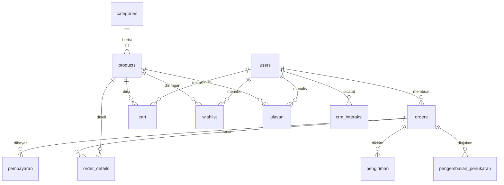

# Budiarti Risol — Website Pemesanan dan Pemasaran UMKM

Website e-commerce untuk UMKM **Budiarti Risol** (Depok): pelanggan bisa
memesan risol secara online, admin mengelola produk, pesanan, pembayaran,
pengiriman, pengembalian, keuangan, dan CRM dari satu panel.

> **Tentang repo ini:** kode sumber lengkap + struktur database. File SQL di
> `database/` sudah **disanitasi**: strukturnya lengkap (16 tabel), tapi data
> pelanggan (nama, email, no HP, alamat, hash password, log pengunjung)
> **tidak ikut** — hanya data katalog (kategori, produk, profil toko).
> Foto bukti pengembalian dari pelanggan juga tidak ikut di repo.

## Fitur

**Pelanggan (`user/`)**
- Katalog produk + detail (komposisi, berat, cocok untuk), kategori
  (Risol Asin, Risol Manis, Paket Hemat), promo, testimoni, blog
- Keranjang, wishlist, checkout (ongkir + alamat lengkap), lacak pesanan
- Pembayaran transfer + upload bukti, verifikasi oleh admin
- Pengajuan pengembalian / penukaran barang + upload foto bukti
- Akun: daftar, masuk, profil, lupa password (reset via email),
  preferensi notifikasi
- Halaman: tentang, kontak, syarat & ketentuan, kebijakan privasi

**Admin (`admin/`)**
- Dashboard, kelola produk & kategori (tambah / ubah / hapus)
- Pesanan: detail, ubah status, lihat bukti pembayaran
- Pembayaran: verifikasi / tolak bukti transfer
- Pengiriman: kurir, nomor resi, status pengiriman
- Pengembalian & penukaran: proses pengajuan pelanggan
- Stok produk, pengguna, CRM + riwayat pelanggan
- Laporan keuangan, pengeluaran, pengaturan toko, log pengunjung

## Teknologi

- PHP (native, mysqli) + MySQL / MariaDB — tanpa framework
- PHPMailer (dibundel di `PHPMailer/`) untuk email reset password via Gmail SMTP
- HTML + CSS + JavaScript (tanpa build step)

## Struktur folder

```
.
├── admin/          Panel admin (34 file PHP)
├── assets/         CSS + gambar produk, kategori, blog
│   ├── css/
│   └── images/
├── config/         Koneksi DB, email, migrasi SQL bertahap
├── database/       Dump database yang sudah disanitasi
├── PHPMailer/      Library PHPMailer (dibundel)
├── uploads/        Folder upload bukti pengembalian (kosong di repo)
└── user/           Halaman pelanggan (28 file PHP)
```

Titik masuk aplikasi: `user/index.php` (tidak ada `index.php` di root).

## Instalasi (localhost, XAMPP)

1. Salin isi repo ini ke `C:\xampp\htdocs\RisolBudiarti\`
   (atau nama folder lain — sesuaikan URL di langkah 4).
2. Jalankan **Apache** dan **MySQL** dari XAMPP Control Panel.
3. Buat database baru di phpMyAdmin (http://localhost/phpmyadmin):
   - Nama database: `budiarti_risol`
   - Import file `database/budiarti_risol.sql`
4. Buka http://localhost/RisolBudiarti/user/
5. **Buat akun admin dulu** — tabel `users` dikirim kosong (data
   pelanggan tidak ikut di repo). Caranya: daftar akun biasa lewat
   `user/register.php`, lalu ubah `role`-nya jadi `admin` di phpMyAdmin
   (tabel `users`, kolom `role`).

## Konfigurasi

- **Database** — `config/koneksi.php` memakai bawaan XAMPP
  (`localhost`, user `root`, tanpa password, database `budiarti_risol`).
  Ubah di file itu kalau memakai host / user / password lain.
- **Email reset password** — `config/email.php` memakai Gmail SMTP.
  Sebelum dipakai, isi `EMAIL_APP_PASSWORD` dengan App Password Gmail
  16 karakter (Google Account → Security → 2-Step Verification →
  App passwords). Nilai aslinya sengaja tidak ada di repo.
- **Migrasi bertahap** — file `config/migration_*.sql` adalah riwayat
  perubahan skema (tahap 3–11, ulasan, foto profil). Tidak perlu
  dijalankan untuk instalasi baru; `database/budiarti_risol.sql`
  sudah berisi skema final.

## Database — skema (16 tabel)

Database: `budiarti_risol`. Foreign key formal ada 6:

| Relasi | Keterangan |
|---|---|
| `cart.id_user` → `users.id_user` | Keranjang milik pengguna |
| `cart.id_product` → `products.id_product` | Keranjang berisi produk |
| `orders.id_user` → `users.id_user` | Pesanan milik pengguna |
| `order_details.id_order` → `orders.id_order` | Detail milik pesanan |
| `order_details.id_product` → `products.id_product` | Detail berisi produk |
| `products.id_category` → `categories.id_category` | Produk masuk kategori |

Relasi lain (pembayaran, pengiriman, pengembalian → pesanan; ulasan,
wishlist → pengguna/produk; crm_interaksi → pengguna) bersifat logis
tanpa foreign key formal.



### `cart` (4 kolom)
| Kolom | Tipe | Keterangan |
|---|---|---|
| `id_cart` | int(11) | PK |
| `id_user` | int(11) | FK → `users` |
| `id_product` | int(11) | FK → `products` |
| `jumlah` | int(11) | Default 1 |

### `categories` (3 kolom)
| Kolom | Tipe | Keterangan |
|---|---|---|
| `id_category` | int(11) | PK |
| `nama_category` | varchar(100) | Nama kategori |
| `gambar_category` | varchar(255) | Nama file gambar (nullable) |

### `crm_interaksi` (6 kolom)
| Kolom | Tipe | Keterangan |
|---|---|---|
| `id_interaksi` | int(11) | PK |
| `id_user` | int(11) | Pengguna yang dihubungi |
| `jenis_interaksi` | varchar(50) | Jenis interaksi |
| `catatan` | text | Catatan (nullable) |
| `tanggal_interaksi` | datetime | Default waktu saat ini |
| `dibuat_oleh` | varchar(100) | Admin pencatat (nullable) |

### `orders` (17 kolom)
| Kolom | Tipe | Keterangan |
|---|---|---|
| `id_order` | int(11) | PK |
| `id_user` | int(11) | FK → `users` |
| `nama_penerima` | varchar(100) | Nama penerima pesanan |
| `no_hp` | varchar(20) | No HP penerima |
| `alamat` | text | Alamat pengiriman |
| `provinsi` | varchar(100) | Provinsi tujuan |
| `kota` | varchar(100) | Kota tujuan |
| `kecamatan` | varchar(100) | Kecamatan tujuan |
| `kode_pos` | varchar(10) | Kode pos tujuan |
| `total_harga` | decimal(12,2) | Total harga barang |
| `ongkir` | decimal(12,2) | Ongkos kirim (default 0) |
| `total_pembayaran` | decimal(12,2) | Total yang harus dibayar |
| `metode_pembayaran` | varchar(50) | Metode bayar (nullable) |
| `status` | enum | Menunggu Pembayaran / Diproses / Dikirim / Selesai / Dibatalkan |
| `created_at` | timestamp | Waktu pesanan dibuat |
| `stok_dikurangi` | tinyint(1) | Penanda stok sudah dipotong (0/1) |
| `bukti_pembayaran` | varchar(255) | Nama file bukti (nullable) |

### `order_details` (6 kolom)
| Kolom | Tipe | Keterangan |
|---|---|---|
| `id_detail` | int(11) | PK |
| `id_order` | int(11) | FK → `orders` |
| `id_product` | int(11) | FK → `products` |
| `jumlah` | int(11) | Jumlah item |
| `harga` | decimal(12,2) | Harga satuan saat beli |
| `subtotal` | decimal(12,2) | jumlah × harga |

### `pembayaran` (10 kolom)
| Kolom | Tipe | Keterangan |
|---|---|---|
| `id_pembayaran` | int(11) | PK |
| `id_order` | int(11) | Pesanan yang dibayar |
| `metode_pembayaran` | varchar(30) | Metode bayar |
| `jumlah` | decimal(12,2) | Nominal dibayar |
| `status_pembayaran` | enum | Menunggu Verifikasi / Terverifikasi / Ditolak / Belum Dibayar / Lunas |
| `bukti_pembayaran` | varchar(255) | Nama file bukti (nullable) |
| `tanggal_bayar` | datetime | Waktu bayar (nullable) |
| `catatan` | varchar(500) | Catatan (nullable) |
| `created_at` | timestamp | Waktu dibuat |
| `updated_at` | timestamp | Terakhir diubah (otomatis) |

### `pengeluaran` (6 kolom)
| Kolom | Tipe | Keterangan |
|---|---|---|
| `id_pengeluaran` | int(11) | PK |
| `tanggal` | date | Tanggal pengeluaran |
| `kategori` | varchar(100) | Kategori pengeluaran |
| `keterangan` | varchar(255) | Keterangan |
| `nominal` | decimal(15,2) | Nominal |
| `created_at` | timestamp | Waktu dibuat |

### `pengembalian_penukaran` (11 kolom)
| Kolom | Tipe | Keterangan |
|---|---|---|
| `id_pengajuan` | int(11) | PK |
| `id_order` | int(11) | Pesanan terkait |
| `id_user` | int(11) | Pengaju |
| `jenis` | enum | Pengembalian / Penukaran |
| `alasan` | varchar(100) | Alasan pengajuan |
| `detail_alasan` | text | Penjelasan (nullable) |
| `bukti_foto` | varchar(255) | Nama file foto bukti (nullable) |
| `status` | enum | Diajukan / Diproses / Disetujui / Ditolak / Selesai |
| `catatan_admin` | text | Catatan admin (nullable) |
| `created_at` | timestamp | Waktu dibuat |
| `updated_at` | timestamp | Terakhir diubah (otomatis) |

### `pengiriman` (10 kolom)
| Kolom | Tipe | Keterangan |
|---|---|---|
| `id_pengiriman` | int(11) | PK |
| `id_order` | int(11) | Pesanan yang dikirim |
| `kurir` | varchar(100) | Nama kurir |
| `nomor_resi` | varchar(100) | Nomor resi |
| `status_pengiriman` | enum | Belum Diproses / Diproses / Dikirim / Dalam Perjalanan / Sampai Tujuan / Selesai / Gagal |
| `tanggal_kirim` | datetime | Waktu kirim (nullable) |
| `estimasi_sampai` | date | Estimasi sampai (nullable) |
| `catatan` | varchar(500) | Catatan (nullable) |
| `created_at` | timestamp | Waktu dibuat |
| `updated_at` | timestamp | Terakhir diubah (otomatis) |

### `preferensi_notifikasi` (5 kolom)
| Kolom | Tipe | Keterangan |
|---|---|---|
| `id_user` | int(11) | PK, pengguna |
| `notif_pesanan` | tinyint(1) | Notifikasi pesanan (default 1) |
| `notif_promo` | tinyint(1) | Notifikasi promo (default 0) |
| `notif_info` | tinyint(1) | Notifikasi info (default 1) |
| `updated_at` | timestamp | Terakhir diubah (otomatis) |

### `products` (11 kolom)
| Kolom | Tipe | Keterangan |
|---|---|---|
| `id_product` | int(11) | PK |
| `id_category` | int(11) | FK → `categories` |
| `nama_product` | varchar(100) | Nama produk |
| `deskripsi` | text | Deskripsi (nullable) |
| `harga` | decimal(12,2) | Harga satuan |
| `stok` | int(11) | Stok (default 0) |
| `gambar` | varchar(255) | Nama file gambar (nullable) |
| `created_at` | timestamp | Waktu dibuat |
| `berat` | varchar(100) | Default '50 gram/pcs' |
| `komposisi` | text | Komposisi (nullable) |
| `cocok_untuk` | text | Cocok untuk (nullable) |

### `settings` (8 kolom)
| Kolom | Tipe | Keterangan |
|---|---|---|
| `id_setting` | int(11) | PK |
| `nama_toko` | varchar(100) | Nama toko |
| `slogan` | varchar(255) | Slogan (nullable) |
| `no_hp` | varchar(30) | No HP toko (nullable) |
| `alamat` | text | Alamat toko (nullable) |
| `logo` | varchar(255) | Nama file logo (nullable) |
| `favicon` | varchar(255) | Nama file favicon (nullable) |
| `updated_at` | timestamp | Terakhir diubah (otomatis) |

### `ulasan` (6 kolom)
| Kolom | Tipe | Keterangan |
|---|---|---|
| `id_ulasan` | int(11) | PK |
| `id_product` | int(11) | Produk yang diulas |
| `id_user` | int(11) | Pengulas |
| `rating` | tinyint(4) | Nilai 1–5 |
| `komentar` | text | Isi ulasan |
| `created_at` | timestamp | Waktu dibuat |

### `users` (7 kolom)
| Kolom | Tipe | Keterangan |
|---|---|---|
| `id_user` | int(11) | PK |
| `nama` | varchar(100) | Nama pengguna |
| `email` | varchar(100) | Email (untuk login) |
| `no_hp` | varchar(20) | No HP (nullable) |
| `password` | varchar(255) | Hash password (bcrypt) |
| `role` | enum | user / admin |
| `created_at` | timestamp | Waktu dibuat |

### `visitor_logs` (6 kolom)
| Kolom | Tipe | Keterangan |
|---|---|---|
| `id_visitor` | bigint(20) unsigned | PK |
| `visitor_key` | char(64) | Kunci pengunjung |
| `halaman` | varchar(100) | Halaman yang dikunjungi |
| `tanggal` | date | Tanggal kunjungan |
| `waktu_kunjungan` | datetime | Waktu kunjungan |
| `id_user` | int(11) | Pengguna (nullable, kalau login) |

### `wishlist` (4 kolom)
| Kolom | Tipe | Keterangan |
|---|---|---|
| `id_wishlist` | int(11) | PK |
| `id_user` | int(11) | Pengguna |
| `id_product` | int(11) | Produk disimpan |
| `created_at` | timestamp | Waktu dibuat |

## Data awal (seed)

File `database/budiarti_risol.sql` berisi data awal berikut (16 baris):

**Kategori (3):** Risol Asin, Risol Manis, Paket Hemat.

**Produk (12):**

| Produk | Kategori | Harga |
|---|---|---|
| Risol Mayo | Risol Asin | Rp5.000 |
| Risol Ayam | Risol Asin | Rp5.000 |
| Risol Beef | Risol Asin | Rp5.000 |
| Risol Sayur | Risol Asin | Rp5.000 |
| Risol Coklat | Risol Manis | Rp5.000 |
| Risol Pisang Coklat | Risol Manis | Rp5.000 |
| Risol Keju | Risol Manis | Rp5.000 |
| Risol Matcha | Risol Manis | Rp5.000 |
| Paket Ramai | Paket Hemat | Rp35.000 |
| Paket Hemat 1 | Paket Hemat | Rp23.000 |
| Paket Hemat 2 | Paket Hemat | Rp23.000 |
| Paket Hemat 3 | Paket Hemat | Rp23.000 |

**Profil toko (1 baris `settings`):** Budiarti Risol — "Risol Lezat,
Buatan Rumah", Jl. Duku II No. 76, Sukamaju Baru, Tapos, Depok 16462.

## Alur pemesanan

1. Pelanggan memilih produk → keranjang → checkout (isi alamat + pilih
   metode pembayaran).
2. Pesanan berstatus **Menunggu Pembayaran**; pelanggan upload bukti
   transfer di halaman pembayaran.
3. Admin memverifikasi bukti di panel **Pembayaran**; pesanan lanjut
   **Diproses** → **Dikirim** (admin isi kurir + resi) → **Selesai**.
4. Pelanggan bisa mengajukan **pengembalian / penukaran** dari riwayat
   pesanan; admin memprosesnya di panel **Pengembalian**.

## Catatan keamanan & data

- **SQL disanitasi** — dump asli berisi data pelanggan (nama, email,
  no HP, alamat, hash password bcrypt, log pengunjung). Semua itu
  dihapus dari file di repo ini; yang tersisa hanya struktur +
  data katalog. Jangan meng-commit dump mentah ke repo publik.
- **App Password Gmail tidak ada di repo** — `config/email.php`
  berisi placeholder; isi sendiri sebelum fitur reset password dipakai.
- **Foto bukti pengembalian tidak ikut** — folder `uploads/` dikirim
  kosong; file upload pelanggan tetap di server lokal saja.
- **Foto kategori belum ada** — 3 baris `categories` merujuk file
  `kategori_*.jpg` yang tidak ada di paket ini; gambar kategori perlu
  di-upload ulang lewat panel admin kalau mau tampil.
- **Tidak ada akun bawaan** — setelah import SQL, buat akun admin
  sendiri (lihat langkah 5 di Instalasi).
